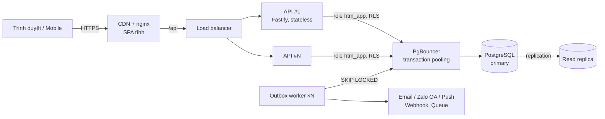
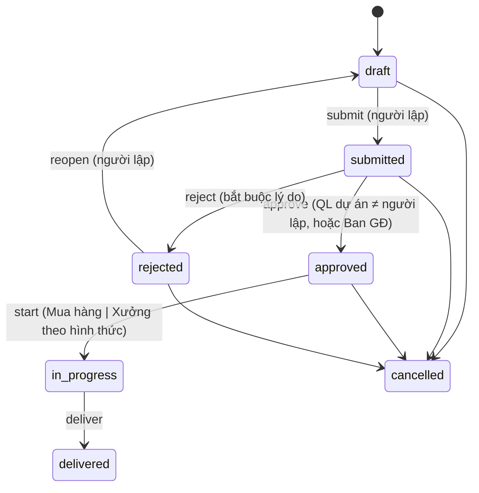

# Kiến trúc hệ thống

## 1. Tổng quan



**Modular monolith**: một API, chia module theo miền nghiệp vụ (`auth`, `org`, `projects`, `material-requests`,
`dashboard`). Đây là lựa chọn có chủ đích cho startup: một lần deploy, một database, transaction ACID xuyên module —
nhưng ranh giới module đủ rõ để tách thành service riêng khi một miền cần scale độc lập.

| Quyết định | Lý do |
|---|---|
| **Multi-tenant bằng `tenant_id` + Row Level Security** | Một database phục vụ hàng nghìn doanh nghiệp. RLS cưỡng chế cô lập ở tầng DB, kể cả khi code quên `WHERE tenant_id`. App dùng role không phải owner nên không bypass được RLS. |
| **API stateless + JWT 15 phút** | Scale ngang tuỳ ý sau load balancer, không cần sticky session. |
| **Refresh token xoay vòng, lưu hash, cookie httpOnly** | Thu hồi được phiên; phát hiện token bị đánh cắp (dùng lại token cũ ⇒ thu hồi cả họ token). |
| **State machine dùng chung** (`packages/shared`) | Một nguồn sự thật cho quyền chuyển trạng thái: API cưỡng chế, UI hiện đúng nút. |
| **Transactional outbox** | Sự kiện (đổi trạng thái đề nghị) ghi cùng transaction với dữ liệu ⇒ không mất thông báo; worker xử lý bất đồng bộ, retry với backoff. |
| **Keyset pagination** | Hiệu năng không đổi ở trang thứ 1 hay thứ 10.000; không lệch khi có bản ghi mới. |
| **`SELECT … FOR UPDATE` khi chuyển trạng thái** | Hai người cùng bấm "Duyệt" ⇒ đúng một lần thành công (có test). |
| **SQL thuần + `pg`** | Kiểm soát hoàn toàn truy vấn và index; không có lớp ORM che giấu chi phí. |

## 2. Cấu trúc file

```
.
├── apps/
│   ├── api/                      # Backend Fastify
│   │   ├── migrations/           # SQL migration đánh số, chạy tuần tự (advisory lock)
│   │   ├── src/
│   │   │   ├── app.ts            # Lắp ráp app: plugin bảo mật, error handler, health, routes
│   │   │   ├── server.ts         # Entry HTTP, graceful shutdown
│   │   │   ├── worker.ts         # Outbox worker
│   │   │   ├── config.ts         # Biến môi trường, validate bằng zod (fail fast)
│   │   │   ├── db/               # pool + withTenant(), migrate, seed (theo sơ đồ tổ chức)
│   │   │   ├── lib/              # errors, password (scrypt), tokens (JWT), cursor, validate
│   │   │   ├── plugins/auth.ts   # authenticate, req.db() gắn tenant, requireRole()
│   │   │   └── modules/
│   │   │       ├── auth/         # login, refresh, logout, me
│   │   │       ├── org/          # phòng ban, người dùng
│   │   │       ├── projects/     # dự án, thành viên, nhật ký công trình
│   │   │       ├── material-requests/  # đề nghị vật tư + state machine + outbox
│   │   │       └── dashboard/    # số liệu tổng quan
│   │   ├── test/                 # test tích hợp trên Postgres thật (RLS, luồng duyệt, đồng thời)
│   │   └── Dockerfile
│   └── web/                      # Frontend React
│       ├── src/
│       │   ├── api/              # client fetch (tự refresh token) + hooks TanStack Query
│       │   ├── auth/             # AuthContext
│       │   ├── components/       # Layout, UI primitives
│       │   ├── pages/            # Mỗi trang một file, lazy-load
│       │   └── styles.css        # Design tokens, light/dark, responsive
│       └── Dockerfile            # build tĩnh + nginx
├── packages/shared/              # Zod schema, DTO, vai trò, state machine — dùng chung API & Web
├── infra/                        # nginx, init role Postgres, ghi chú triển khai
├── docs/
├── docker-compose.yml
└── .github/workflows/ci.yml
```

## 3. Mô hình phân quyền

Vai trò (một người có thể giữ nhiều vai trò), ánh xạ từ sơ đồ tổ chức:

| Vai trò | Ai (theo sơ đồ) | Quyền chính |
|---|---|---|
| `admin` | Giám đốc | Quản lý người dùng, toàn quyền |
| `director` | Giám đốc, PGĐ-Trưởng P. Dự án | Xem mọi dự án, duyệt mọi đề nghị |
| `manager` | Phó phòng, Phụ trách phòng, Quản đốc | Tạo dự án; quản lý & duyệt đề nghị của dự án mình phụ trách |
| `procurement` | Phó P. Dự án phụ trách mua hàng, NV mua hàng | Xem mọi đề nghị; tiếp nhận & giao đề nghị *mua ngoài* |
| `workshop` | Xưởng SX (Quản đốc, kho Ninh Bình, bóc tách) | Tiếp nhận & giao đề nghị *sản xuất* |
| `accountant` | P. Hành chính kế toán | Xem mọi dự án/đề nghị để đối soát |
| `staff` | Còn lại | Chỉ thấy dự án mình tham gia; lập đề nghị, ghi nhật ký |

State machine đề nghị vật tư:



## 4. Kiến trúc UI

- **SPA React 18 + React Router**, mỗi trang lazy-load (bundle đầu ~84 KB gzip).
- **TanStack Query** là lớp state server duy nhất: cache, invalidation sau mutation, infinite query cho keyset pagination.
  Không cần Redux.
- **Bảo mật token**: access token chỉ trong bộ nhớ; refresh token trong cookie httpOnly `SameSite=Strict` path `/api/v1/auth`.
  Client tự refresh khi gặp 401 (single-flight, tránh dùng refresh token hai lần).
- **Schema dùng chung**: form và API dùng cùng enum/nhãn tiếng Việt từ `@htm/shared`; nút thao tác lấy từ `actions`
  do API tính bằng chính state machine dùng chung.
- **Thiết kế**: design tokens CSS, tự động dark mode, responsive tới 390px (sidebar chuyển thành thanh tab).

Trang: Đăng nhập · Tổng quan (việc chờ tôi, số liệu) · Đề nghị vật tư (Chờ tôi / Tôi lập / Tất cả) · Tạo đề nghị ·
Chi tiết đề nghị (stepper, hạng mục, lịch sử, thao tác) · Dự án · Chi tiết dự án (thông tin, thành viên, nhật ký, đề nghị) ·
Cơ cấu tổ chức.

## 5. Bảo mật

- Mật khẩu băm scrypt (salt riêng, tham số tự mô tả để nâng cấp). So sánh thời gian hằng; hash giả khi email không tồn tại.
- Rate limit toàn cục + chặt hơn cho `/auth/login` (10/phút/IP).
- Helmet, CORS whitelist, body limit 1 MB, statement timeout 10s.
- Mọi input validate bằng zod; lỗi trả về thống nhất `{ error: { code, message, details, requestId } }`.
- Không tiết lộ sự tồn tại của tài nguyên người dùng không được xem (trả 404 thay vì 403).
- Log có `requestId`, tự che `authorization` và `cookie`.
