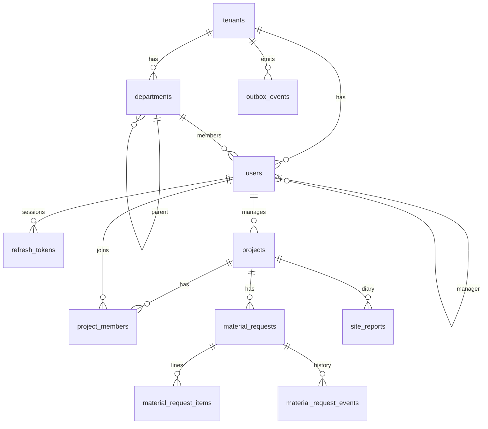

# Database schema

PostgreSQL 16. Nguồn sự thật: [`apps/api/migrations`](../apps/api/migrations).

| Bảng | Mục đích | Ghi chú |
|---|---|---|
| `tenants` | Doanh nghiệp khách hàng | `slug` dùng khi đăng nhập. Không RLS (app chỉ có quyền SELECT). |
| `departments` | Cây phòng ban | `parent_id`, `head_user_id`, `decision_ref` (số QĐ kiện toàn) |
| `users` | Nhân sự + tài khoản | `roles text[]`, `grade_code` (mã ngạch, ví dụ B.05), `manager_id` (báo cáo cho) |
| `refresh_tokens` | Phiên đăng nhập | Chỉ lưu SHA-256; `replaced_by` cho chuỗi xoay vòng |
| `projects` | Dự án / công trình | `region` (bắc/trung/nam), `manager_id` là người duyệt mặc định |
| `project_members` | Thành viên dự án | Quyết định ai được xem/ghi |
| `material_requests` | Đề nghị vật tư | `code` VT-YYYY-NNNNN, `fulfillment` purchase/production, `status`, `version` |
| `material_request_items` | Hạng mục | `numeric(18,3)` cho số lượng lẻ (m, kg) |
| `material_request_events` | Lịch sử trạng thái | Append-only, phục vụ audit |
| `site_reports` | Nhật ký công trình | Duy nhất theo (dự án, ngày, người ghi) |
| `doc_counters` | Cấp số chứng từ theo tenant/năm | Upsert có khoá dòng ⇒ không trùng số |
| `outbox_events` | Sự kiện chờ xử lý | Partial index trên bản ghi chưa xử lý |

## Nguyên tắc

- **Mọi bảng nghiệp vụ có `tenant_id`** và policy `tenant_isolation` (`ENABLE` + `FORCE ROW LEVEL SECURITY`).
  Ngữ cảnh tenant đặt bằng `set_config('app.tenant_id', $1, true)` trong từng transaction (`withTenant()`).
- **Index bắt đầu bằng `tenant_id`**, khớp với mẫu truy vấn; danh sách dùng `(tenant_id, created_at DESC, id DESC)` cho keyset.
- **Ràng buộc ở DB** (CHECK trạng thái, khoảng ngày, số lượng > 0, UNIQUE mã) — không chỉ dựa vào code.
- **Hai role**: owner (`htm`) chạy migration; `htm_app` chỉ có DML, không sở hữu bảng ⇒ không bypass RLS.
- Migration chỉ thêm (forward-only), mỗi file chạy trong transaction, có advisory lock.
